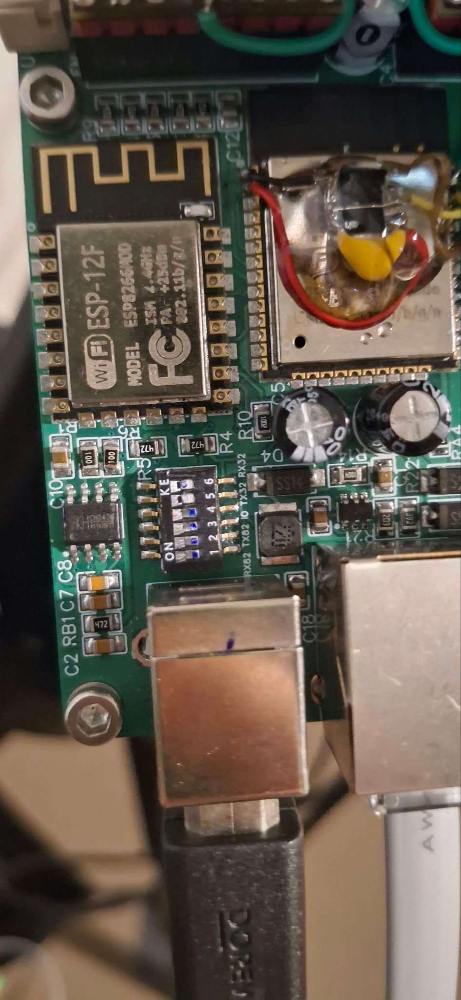
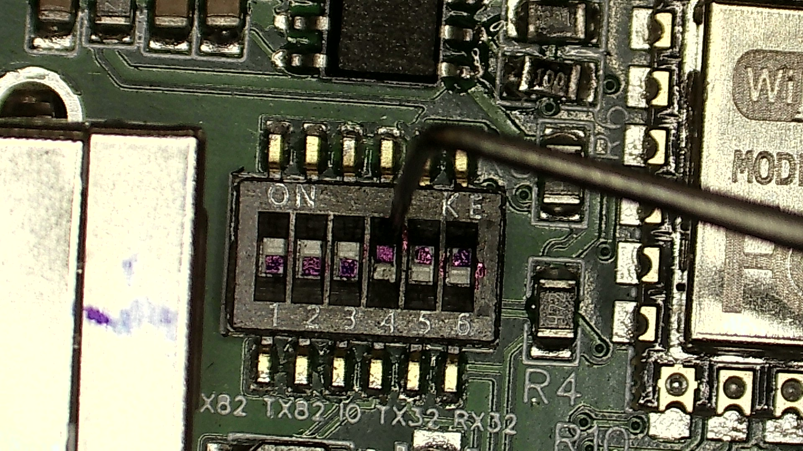
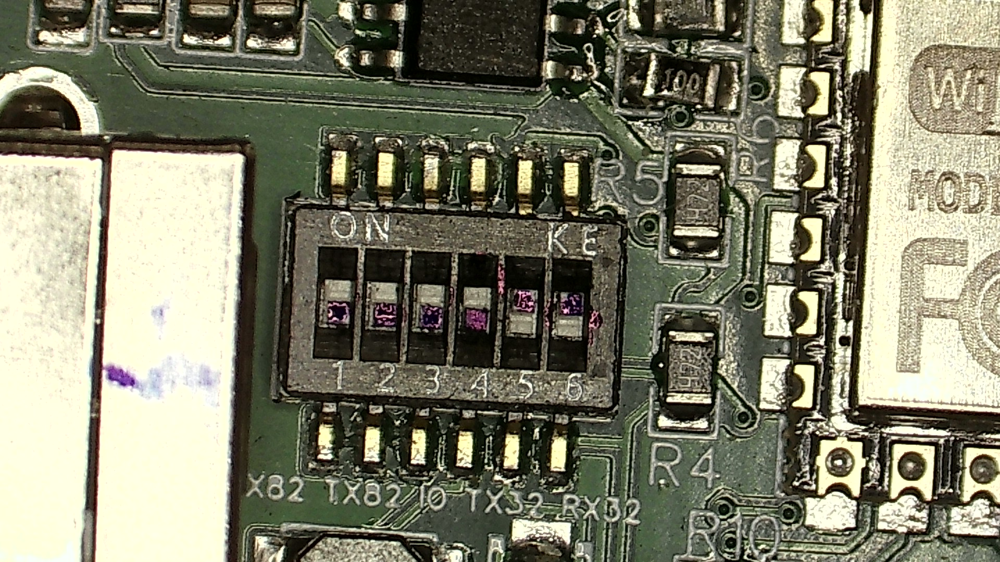

# JUWEI17 OnStepX 10.28x Firmware

This is the OnStepX 10.28x setup used for the JUWEI17 upgrades described below: TMC2209 UART control, FRAM, 400-step motors, shorter belts, and a lower-profile RA brake. It includes the firmware source and a Windows build/upload helper, based on upstream OnStepX commit `65a751825677a03a0b12b15546780b614a206435`.

> **Before moving the mount:** this setup uses `7184.222` steps per degree on both axes. Uploading firmware does not replace existing runtime settings. Follow the [FRAM procedure](#fram), restart the controller, and check the saved settings again before testing motion.

## JUWEI17 board modifications

These photos show the modified PCB, new stepper motor drivers, and added UART and FRAM wiring. They are not wiring diagrams: check your board revision and the [JUWEI17 pinmap](firmware/OnStepX/src/pinmaps/Pins.Juwei17.h) before copying a connection.


*Overall view of the JUWEI17 board, ESP32 module, driver modules, and wiring modifications.*


*Controller wiring close-up. Signal assignments are in the pinmap linked above.*



*Driver-header area and jumper wiring associated with the TMC2209 UART modification.*

## TMC2209 hardware UART

The JUWEI17 pinmap selects `Serial1` at 115200 baud. In the ESP32 pinmap, GPIO 5 is UART TX and GPIO 23 is UART RX:

```cpp
#define SERIAL_TMC          Serial1
#define SERIAL_TMC_BAUD     115200
#define SERIAL_TMC_RX       23
#define SERIAL_TMC_TX       5
#define SERIAL_TMC_ADDRESS_MAP(axis) ((axis == 0) ? 0 : ((axis == 1) ? 1 : 3))
```

Both RA and DEC axes are configured for TMC2209 UART operation:

```cpp
#define AXIS1_DRIVER_MODEL       TMC2209
#define AXIS1_DRIVER_UART       ON
#define AXIS2_DRIVER_MODEL       TMC2209
#define AXIS2_DRIVER_UART       ON
```

UART lets OnStepX set the driver microsteps and run/hold current settings. The original drivers were V985 TMC2209 modules which are not UART enabled. These were replaced with 2x BigTreeTech (BTT) v1.3 TMC2209. Their supplied heatsinks were found to be too tall for the JUWEI17 cavity. Shorter [heatsinks](https://www.ebay.com.au/itm/184650895461) were needed. Check clearance, cooling, and the current setting for the stepper motor drivers you actually install.

The TMC2209 UART interface is single-wire. The ESP32 TX/RX labels describe the controller-side signals; confirm how the JUWEI17 board joins them to the driver's UART pin. Maintain a common signal ground and compatible logic levels. Do not connect ESP32 GPIO to the motor-supply rail.

### Driver addresses and board revisions

RA and DEC share the UART bus, so they need different addresses. The pinmap expects the following **states at the TMC2209 chip's address inputs**, not a particular jumper position:

| Axis | UART address | MS1 / AD0 | MS2 / AD1 |
| --- | --- | --- | --- |
| RA (axis 1) | 0 | LOW | LOW |
| DEC (axis 2) | 1 | HIGH | LOW |

The JUWEI17 pinmap sets both axes' M0/M1 control pins to `OFF`. Firmware cannot set these address inputs for you; the module/socket wiring must establish them.

- **Original V985 modules:** verify the pin labels, onboard pulls, and socket connections on your actual revision. This repository does not include a verified V985 schematic or jumper map.
- **BTT v1.3 replacements:** use the schematic and pinout for the exact module revision. Check the UART solder bridge and MS1/MS2 connections before fitting it; do not assume a V985 modification transfers directly. BTT publishes module documentation in its [TMC2209 repository](https://github.com/bigtreetech/BIGTREETECH-TMC2209-V1.2).
- **Other revisions:** establish the same chip-level address states from their own documentation. The photos here are not enough to identify which jumper or pad to change.

Disconnect USB and motor power before checking continuity or changing wiring. Confirm that no socket connection drives an address input against its strap, and that both modules' PDN_UART signals reach the shared bus. HIGH means the module's compatible logic supply, not 12 V. If you cannot confirm the connections, stop rather than guessing.

### Checking UART communication

1. With the mount unloaded and stationary, finish the FRAM procedure below and restart with the drivers powered.
2. For a diagnostic build, set `DEBUG` to `VERBOSE` in [Extended.config.h](firmware/OnStepX/Extended.config.h) and add `#define MOTOR_DRIVER_DETECT`. Capture the startup log on USB at `SERIAL_DEBUG_BAUD` (230400 in this source); do not use that port for normal mount commands while debugging.
3. Check the startup messages for **both axes**: RX 23, TX 5, 115200 baud, 16 microsteps, and the intended hold/run/goto settings. Treat missing-driver errors as a failure.
4. A startup log or moving motor is not proof of two-way UART communication. The legacy driver can fall back to one-way operation. For a positive check, use a UART diagnostic or logic analyser to confirm valid TMC2209 register replies for address 0 and address 1 independently. Read IOIN to identify each TMC2209, check CHOPCONF for the programmed microsteps, and confirm IFCNT increments after a register write (the 8-bit counter wraps). Controller TX echo alone is not a driver reply. OnStep's `:GXA...#` commands below read stored settings, not these driver registers.
5. Return `DEBUG` to `OFF`, remove the diagnostic define, rebuild/upload, and repeat the post-restart settings checks before normal use.

## FRAM

This build uses MB85RC64 FRAM (`NV_MB85RC64`). When runtime axis settings are enabled, the saved values take precedence over [Config.h](firmware/OnStepX/Config.h). A firmware upload does not reset them.

### Set, restart, then verify

Use a mount-control application's raw OnStep command facility, or a serial terminal on the normal USB command port (9600 baud by default, with `DEBUG OFF`). Send one command at a time, including the final `#`. These commands and parameter numbers are for the 10.28x source in this repository.

1. Stop tracking and slewing, unload the mount, and keep it stationary. Query `:GVN#` and confirm the expected firmware version. Record existing axis settings before changing them, especially direction and travel limits.
2. Send `:SXAC,0#` to enable runtime axis settings. Expect `1` for success; `0` is failure. Restart the controller and reconnect before proceeding, so any pending revert/default settings are handled during initialization. Keep the drivers powered whenever the controller starts.
3. Read the parameters in the table below for both axes. Each read returns `value,min,max,type,name#`; compare the **first field**, not the whole reply, with the target. A bare `0` or missing response is not a valid parameter readback. Check the returned name too, and stop if it does not match the intended setting.
4. Write any values that differ, using `:SXA1,p,value#` for RA and `:SXA2,p,value#` for DEC. Each write must return `1`. For example, send `:SXA1,1,7184.222#` and `:SXA2,1,7184.222#` to set the axis scales. Use the same format for microsteps and currents in the table.

   Choose the write order from the old values: tracking microsteps must stay at least as large as goto microsteps, and hold current must not exceed run current. Lower goto microsteps before lowering tracking microsteps if needed. Lower hold current before lowering run current, or raise run current before raising hold current. Do not continue past a rejected write.

| Parameter `p` | Setting | Target for both axes | RA read | DEC read |
| --- | --- | --- | --- | --- |
| 1 | Steps per degree | 7184.222 | `:GXA1,1#` | `:GXA2,1#` |
| 5 | Tracking microsteps | 16 | `:GXA1,5#` | `:GXA2,5#` |
| 6 | Goto microsteps | 16 | `:GXA1,6#` | `:GXA2,6#` |
| 7 | Hold current setting (mA) | 500 | `:GXA1,7#` | `:GXA2,7#` |
| 8 | Run current setting (mA) | 1200 | `:GXA1,8#` | `:GXA2,8#` |
| 9 | Goto current setting (mA) | 1200 | `:GXA1,9#` | `:GXA2,9#` |

`OFF` goto overrides in Config.h resolve to the tracking microsteps and run current when defaults are loaded. Existing FRAM overrides do not automatically follow a later change to those values, so check the goto parameters explicitly.

5. Read all twelve values back while still stationary. This confirms what was saved, **not what is currently active**. These parameters take effect at startup, not when the write command returns.
6. Allow the FRAM writes to finish, then power-cycle the controller and reconnect. Query `:GVN#` again and repeat every read in the table. Check that the values survived the restart. If they did not, investigate FRAM and runtime-settings selection before moving anything.
7. Complete the UART checks above. Then test a small, low-speed movement on each unloaded axis, checking direction and measured travel. Stop if either is wrong; do not try to compensate by changing the steps-per-degree value blindly.

If an axis read still returns a bare `0` after the first restart, check for disabled runtime settings or a pending axis revert. `:SXA1,R#` / `:SXA2,R#` reset an axis to compiled defaults on the **next boot**, including its direction, limits, and driver settings. Use them only when you intend that full reset, then restart and repeat the checks. A whole-device `NV_WIPE` is not needed for this procedure.

## 400-step motors

The existing 200 step motors have been upgraded with higher quality 400 step motors. For this the below Moons Industries NEMA17 units with 400 full steps per revolution (0.9 degrees per step) were chosen:

- **RA:** [MS17HA2P4150-M](https://www.moonsindustries.com/p/nema-17-high-precision-hybrid-stepper-motors/ms17ha2p4150-m-000004611110027530), the double-shaft version. The upper shaft engages the brake mounted above the motor.
- **DEC:** [MS17HA2P4150](https://www.moonsindustries.com/p/nema-17-high-precision-hybrid-stepper-motors/ms17ha2p4150-000004611110015918), the single-shaft version.

At 16 microsteps, that is 6400 commands per motor revolution. It is not the mount's steps-per-degree value: the belt gearing and harmonic drive also contribute.

```text
axis steps per degree = motor full steps per revolution * microsteps * gear reduction * harmonic-drive reduction / 360
```

For this drive train, both axes are configured at **7184.222 steps per degree**, with 16 microsteps, a 500 mA hold setting, and a 1200 mA run setting. Use the FRAM table above to match the saved settings to this configuration; different gearing needs its own calculation and travel check.

## Observed guiding

Reported guiding was roughly 0.9 arcsec RMS before the changes (about +/-0.4 arcsec spread) and 0.6 arcsec RMS afterwards (+/-0.3 arcsec spread). These were informal observations, not a controlled comparison. Conditions and measurement details were not recorded, so treat them as experience with this setup rather than a promised improvement.

## Belt adjustment

The original 118 mm belts were too slack for the available adjustment. Shorter Gates 2GT belts (2 mm pitch, 10 mm wide) left room to tension them without keeping the motors at the ends of their slots. The lengths that worked for this mount were:

- DEC: 114 mm
- RA: 116 mm

Confirm belt routing, tooth profile, and tension after installation; avoid over-tensioning the belts or loading the motor bearings.

## Shorter height profile 12 V RA brake

A square 42 mm, 12 V electromagnetic spring brake from [AliExpress](https://www.aliexpress.com/item/1005009190233217.html?spm=a2g0o.order_list.order_list_main.246.4f391802YLqfFH) fits the RA axis with a lower height profile. With this brake, the motor can be removed without stripping the whole mount; the original brake obstructed removal from the motor cavity.

Choose the **12 V version** and check the dimensions against your mount before ordering.

## Build

Install Arduino CLI, the `esp32:esp32` core, and the libraries needed by this OnStepX configuration. The helper looks in the usual Arduino IDE install location, then on `PATH`. Run it from the repository root:

```powershell
powershell.exe -NoProfile -ExecutionPolicy Bypass -File .\scripts\build-esp32.ps1
```

If the CLI is somewhere else, pass its path:

```powershell
powershell.exe -NoProfile -ExecutionPolicy Bypass -File .\scripts\build-esp32.ps1 -CliPath "C:\Tools\arduino-cli.exe"
```

By default, the helper uses the Arduino15 configuration directory. It does **not** search `%TEMP%` for configuration files. To use a specific Arduino CLI YAML file, pass `-ConfigFile`; this replaces the default `--config-dir` selection and is used for both compilation and upload:

```powershell
powershell.exe -NoProfile -ExecutionPolicy Bypass -File .\scripts\build-esp32.ps1 -CliPath "C:\Tools\arduino-cli.exe" -ConfigFile "C:\Tools\arduino-cli.yaml"
```

The helper builds [firmware/OnStepX](firmware/OnStepX) with the ESP32 `huge_app` partition layout and writes images to `build\esp32`. Use `-OutputDirectory` to change that location. Without `-UploadPort`, it only compiles. It never writes FRAM settings.

To check the helper without Arduino CLI or a connected mount, run the [regression tests](scripts/tests/build-esp32.Tests.ps1):

```powershell
powershell.exe -NoProfile -ExecutionPolicy Bypass -File .\scripts\tests\build-esp32.Tests.ps1
```

These use a mock CLI to check configuration selection, upload arguments, and failure handling. They do not validate the firmware or hardware.

## Flashing the JUWEI17 ESP32

1. Connect the JUWEI17 board to the computer with a data-capable USB cable and identify its serial port in Device Manager.
2. Power off the board before changing the DIP switches. Set the switch block to the ESP32 flashing position shown below. Only use this switch arrangement when the board and switch labels match the photo.

	With the printed `ON` label above the six-switch bank and switches numbered 1–6 left to right, the supplied flashing photo shows **1–2 OFF and 3–6 ON**. The normal run photo shows **1–3 OFF and 4–6 ON**. These are JUWEI-17 board-specific positions, not generic ESP32 settings; confirm the switch numbering and `ON` orientation on your board before changing them. The [OnStep Group flashing report](https://onstep.groups.io/g/main/message/58893) also describes switches 3–6 ON, but its author is unsure whether switch 3 is required. Espressif's [ESP32 boot-mode guide](https://docs.espressif.com/projects/esptool/en/latest/esp32/advanced-topics/boot-mode-selection.html) explains the chip-level requirement: GPIO0 must be low during reset to enter the serial bootloader. It does not define the JUWEI-17 DIP mapping.

	

3. Build the firmware as described above.

4. With the DIP switches still in the flashing position, connect the board's 12 V supply and turn on its power switch before uploading. Keep the USB cable connected. The [OnStep Group flashing report](https://onstep.groups.io/g/main/message/58893) describes using USB and 12 V power during flashing; confirm the correct supply for your board revision.

5. Build and upload with the same helper, replacing `COMx` with your board's port:

	```powershell
	powershell.exe -NoProfile -ExecutionPolicy Bypass -File .\scripts\build-esp32.ps1 -UploadPort "COMx"
	```

	If you used `-CliPath`, `-ConfigFile`, or `-OutputDirectory` above, pass the same options here. For example:

	```powershell
	powershell.exe -NoProfile -ExecutionPolicy Bypass -File .\scripts\build-esp32.ps1 -CliPath "C:\Tools\arduino-cli.exe" -ConfigFile "C:\Tools\arduino-cli.yaml" -UploadPort "COMx"
	```

	This recompiles before uploading, uses the selected CLI and configuration for both steps, and uploads at 115200 baud. A compile failure stops the upload; an upload failure is returned as a nonzero exit code.

6. Wait for the upload to finish successfully. Power off the board, return the DIP switches to the normal run position shown below, then power the board back on.

	

7. Reconnect with your mount-control software and query `:GVN#`. A successful upload does not prove the application booted or that the saved settings are right. Follow the [FRAM procedure](#fram) and UART checks before moving the mount.

The next two supplied images are the separate ESP-12F/ESP8266 references: one shows its flashing setup, and the other the USB-to-ESP-12F adapter. They are not for flashing the JUWEI17 ESP32. Espressif's [ESP8266 boot-mode guide](https://docs.espressif.com/projects/esptool/en/latest/esp8266/advanced-topics/boot-mode-selection.html) says GPIO0 must be low on reset for serial programming, with GPIO2 high and GPIO15 low. The [OnStep Group report](https://onstep.groups.io/g/main/message/58893) describes a JUWEI-17 ESP8266 DIP setting but is explicitly uncertain about whether switch 4 is required; treat those switch positions as unverified unless confirmed against the board documentation.


## Source layout

- `firmware/OnStepX/` - complete customized OnStepX source, including the JUWEI17 `Config.h`, `Extended.config.h`, and `Pins.Juwei17.h` pinmap.
- `firmware/OnStepX/LICENSE` - upstream OnStepX GPL license.
- [scripts/build-esp32.ps1](scripts/build-esp32.ps1) - ESP32 build helper, with optional upload using the same CLI and configuration.
- `assets/` - user-supplied JUWEI17 board and flashing photos.

## License and attribution

The OnStepX firmware is licensed under GNU GPL version 3 or later; see [`LICENSE`](LICENSE) and `firmware/OnStepX/LICENSE`. OnStepX is by Howard Dutton. The JUWEI17 configuration and board-specific changes are identified in the firmware source. This repository does not include a firmware image or claim that a particular image is currently installed on the mount.
