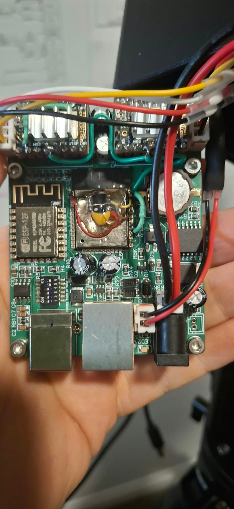

# JUWEI17 OnStepX 10.28x Firmware

This repository contains the complete JUWEI17-customized OnStepX 10.28x source tree, configuration, build helper, and notes for the UART, FRAM, and motor upgrades. The source is based on upstream OnStepX commit `65a751825677a03a0b12b15546780b614a206435`.

> **Hardware and FRAM note:** `7184.222` steps per degree is the correct mount-axis scale for both axes. Initialize the runtime FRAM settings to `7184.222` for each axis and verify the readback. A firmware upload alone does not initialize FRAM settings.

## JUWEI17 board modifications

The photos below document the modified controller, the driver area, and the added wiring. They are reference photos rather than pin-by-pin schematics; verify each conductor against the board revision and the source pinmap before making changes.



*Overall view of the JUWEI17 board, ESP32 module, driver modules, and wiring modifications.*


*Close view of the controller and added wiring. Use the Config and pinmap files below for signal definitions.*


*Driver-header area and jumper wiring associated with the TMC2209 UART modification.*

## TMC2209 hardware UART

The JUWEI17 pinmap selects `Serial1` at 115200 baud. In the ESP32 pinmap, GPIO 5 is UART TX and GPIO 23 is UART RX:

```cpp
#define SERIAL_TMC          Serial1
#define SERIAL_TMC_BAUD     115200
#define SERIAL_TMC_RX       23
#define SERIAL_TMC_TX       5
#define SERIAL_TMC_ADDRESS_MAP(axis) ((axis == 0) ? 0 : ((axis == 1) ? 1 : 3))
```

Both RA and DEC axes are configured for TMC2209 UART operation:

```cpp
#define AXIS1_DRIVER_MODEL       TMC2209
#define AXIS1_DRIVER_UART       ON
#define AXIS2_DRIVER_MODEL       TMC2209
#define AXIS2_DRIVER_UART       ON
```

BigTreeTech (BTT) v1.3 TMC2209 driver modules have been used, fitted with custom finned heatsinks. Check heatsink clearance and driver temperature in the assembled controller, and set current limits for the actual motors and cooling conditions.

The TMC2209 UART interface is single-wire. The ESP32 TX/RX labels describe the controller-side signals; confirm how the JUWEI17 board joins them to the driver's UART pin. Maintain a common signal ground and compatible logic levels. Do not connect ESP32 GPIO to the motor-supply rail.

## FRAM

The firmware selects the MB85RC64 FRAM driver with `NV_MB85RC64`. Runtime axis settings stored in FRAM override the corresponding `Config.h` defaults. For this setup, initialize both axis settings to `7184.222` steps per degree and verify the readback before operating the mount.

This target matches `AXIS1_STEPS_PER_DEGREE` and `AXIS2_STEPS_PER_DEGREE` in the 10.28x source. Firmware upload and FRAM initialization/readback are separate operations.

## 400-step motors

The upgrade uses Moons Industries NEMA17 motors rated at 400 full steps per revolution (0.9 degrees per full step): **MS17HA2P4150-M on RA** and **MS17HA2P4150 on DEC**. At 16 microsteps, the driver receives 6400 microstep commands per motor revolution; this is the motor-side count, not the mount-axis steps-per-degree value. The final axis scale also includes the intervening gear reduction and the harmonic-drive reduction:

```text
axis steps per degree = motor full steps per revolution * microsteps * gear reduction * harmonic-drive reduction / 360
```

The 10.28x `Config.h` sets `AXIS1_STEPS_PER_DEGREE` and `AXIS2_STEPS_PER_DEGREE` to **7184.222**. That is the configured mount-axis scale for this setup, incorporating the full drive train rather than only the motor's 6400 microsteps per revolution. The source also sets both axes to 16 microsteps, 500 mA hold current, and 1200 mA run current. Initialize the runtime FRAM values to match the configured axis scale. Start unloaded at low speed and check direction and measured travel.

## Belt adjustment

The original 118 mm belts left excessive slack with the JUWEI17 motor mounting positions fixed. Replacing them with shorter Gates 2GT timing belts (2 mm pitch, 10 mm width) brought the motors inward from the ends of their mounting slots, taking up the excess slack while retaining room to adjust belt tension. These lengths were found to be optimal:

- DEC: 114 mm
- RA: 116 mm

Confirm belt routing, tooth profile, and tension after installation; avoid over-tensioning the belts or loading the motor bearings.

## Shorter height profile 12 V RA brake

A square 42 mm, 12 V electromagnetic spring brake from [AliExpress](https://www.aliexpress.com/item/1005009190233217.html?spm=a2g0o.order_list.order_list_main.246.4f391802YLqfFH) has been used on the RA axis. This brake style has allowed the RA motor to be installed and removed without fully disassembling the mount. The original RA brake style obstructed removal from the motor cavity and required a full mount strip.

Confirm the brake's mechanical dimensions, coil voltage, retention, and clearance for the specific mount before fitting it. Disconnect power before servicing.

## Build

Install the ESP32 Arduino core and dependencies required by OnStepX, then run the PowerShell helper from the repository root:

```powershell
powershell.exe -NoProfile -ExecutionPolicy Bypass -File .\scripts\build-esp32.ps1
```

The helper builds the `firmware/OnStepX` sketch for the ESP32 `huge_app` partition layout. It does not upload firmware or write FRAM.

## Source layout

- `firmware/OnStepX/` - complete customized OnStepX source, including the JUWEI17 `Config.h`, `Extended.config.h`, and `Pins.Juwei17.h` pinmap.
- `firmware/OnStepX/LICENSE` - upstream OnStepX GPL license.
- `scripts/build-esp32.ps1` - compile-only ESP32 build helper.
- `assets/` - user-supplied JUWEI17 board photos.

## License and attribution

The OnStepX firmware is licensed under GNU GPL version 3 or later; see [`LICENSE`](LICENSE) and `firmware/OnStepX/LICENSE`. OnStepX is by Howard Dutton. The JUWEI17 configuration and board-specific changes are identified in the firmware source. This repository does not include a firmware image or claim that a particular image is currently installed on the mount.