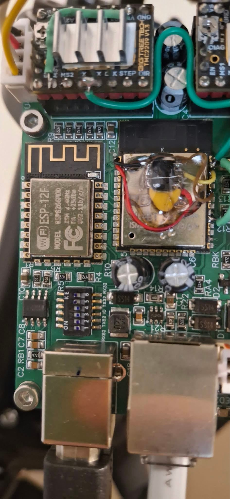
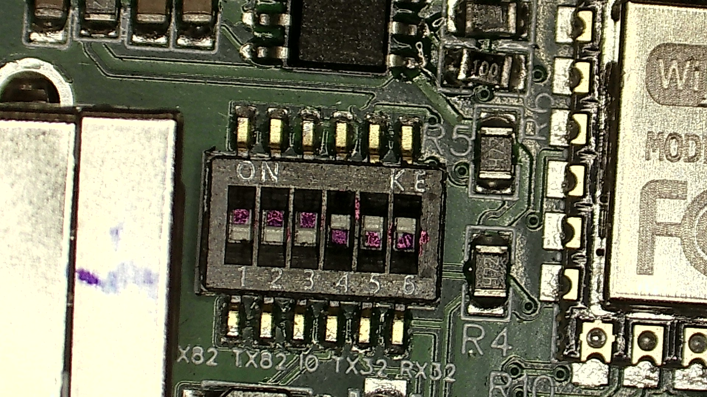

# JUWEI17 OnStepX 10.28x Firmware

This repository contains the complete JUWEI17-customized OnStepX 10.28x source tree, configuration, build helper, and notes for the UART, FRAM, and motor upgrades. The source is based on upstream OnStepX commit `65a751825677a03a0b12b15546780b614a206435`.

> **Hardware and FRAM note:** `7184.222` steps per degree is the correct mount-axis scale for both axes. Initialize the runtime FRAM settings to `7184.222` for each axis and verify the readback. A firmware upload alone does not initialize FRAM settings.

## JUWEI17 board modifications

The photos below document the modified PCB, the new stepper motor drivers, and the added UART and FRAM wiring. They are reference photos rather than pin-by-pin schematics; verify each conductor against the board revision and the source pinmap before making changes.


*Overall view of the JUWEI17 board, ESP32 module, driver modules, and wiring modifications.*



*Close view of the controller and added wiring. Use the Config and pinmap files below for signal definitions.*


*Driver-header area and jumper wiring associated with the TMC2209 UART modification.*

## TMC2209 hardware UART

The JUWEI17 pinmap selects `Serial1` at 115200 baud. In the ESP32 pinmap, GPIO 5 is UART TX and GPIO 23 is UART RX:

```cpp
#define SERIAL_TMC          Serial1
#define SERIAL_TMC_BAUD     115200
#define SERIAL_TMC_RX       23
#define SERIAL_TMC_TX       5
#define SERIAL_TMC_ADDRESS_MAP(axis) ((axis == 0) ? 0 : ((axis == 1) ? 1 : 3))
```

Both RA and DEC axes are configured for TMC2209 UART operation:

```cpp
#define AXIS1_DRIVER_MODEL       TMC2209
#define AXIS1_DRIVER_UART       ON
#define AXIS2_DRIVER_MODEL       TMC2209
#define AXIS2_DRIVER_UART       ON
```

The impetus for the UART upgrade was to configure the motor drive from OnStepX instead of setting it only with the drivers' adjustment potentiometers. On the TMC2209, UART controls the motor coil-current limits (such as run and hold current); it does not change the board's motor-supply voltage. The configured current values are shown in the 400-step motor section below.

The original stepper-driver modules were V985 TMC2209s. BigTreeTech (BTT) v1.3 TMC2209 modules have also been used, fitted with custom finned heatsinks. Check clearance of the heatsinks it was found that the heatsinks that come with the BigTreeTech TMC2209s were too tall for the Juwei17 cavity so some shorter height [heat sinks](https://www.ebay.com.au/itm/184650895461) had to be sourced. 

The TMC2209 UART interface is single-wire. The ESP32 TX/RX labels describe the controller-side signals; confirm how the JUWEI17 board joins them to the driver's UART pin. Maintain a common signal ground and compatible logic levels. Do not connect ESP32 GPIO to the motor-supply rail.

## FRAM

The firmware selects the MB85RC64 FRAM driver with `NV_MB85RC64`. Runtime axis settings stored in FRAM override the corresponding `Config.h` defaults. For this setup, initialize both axis settings to `7184.222` steps per degree and verify the readback before operating the mount.

This target matches `AXIS1_STEPS_PER_DEGREE` and `AXIS2_STEPS_PER_DEGREE` in the 10.28x source. Firmware upload and FRAM initialization/readback are separate operations.

## 400-step motors

The upgrade uses Moons Industries NEMA17 motors rated at 400 full steps per revolution (0.9 degrees per full step): **[MS17HA2P4150-M on RA](https://www.moonsindustries.com/p/nema-17-high-precision-hybrid-stepper-motors/ms17ha2p4150-m-000004611110027530)** and **[MS17HA2P4150 on DEC](https://www.moonsindustries.com/p/nema-17-high-precision-hybrid-stepper-motors/ms17ha2p4150-000004611110015918)**. The `-M` RA model is the double-shaft version and is required for the brake-above-motor arrangement described below: the shaft extends from both ends, so the upper end can engage the brake. The DEC motor is the single-shaft version. At 16 microsteps, the driver receives 6400 microstep commands per motor revolution; this is the motor-side count, not the mount-axis steps-per-degree value. The final axis scale also includes the intervening gear reduction and the harmonic-drive reduction:

```text
axis steps per degree = motor full steps per revolution * microsteps * gear reduction * harmonic-drive reduction / 360
```

The 10.28x `Config.h` sets `AXIS1_STEPS_PER_DEGREE` and `AXIS2_STEPS_PER_DEGREE` to **7184.222**. That is the configured mount-axis scale for this setup, incorporating the full drive train rather than only the motor's 6400 microsteps per revolution. The source also sets both axes to 16 microsteps, 500 mA hold current, and 1200 mA run current. Initialize the runtime FRAM values to match the configured axis scale. Start unloaded at low speed and check direction and measured travel.

## Observed guiding

Anecdotal guiding reports put pre-modification performance at about 0.9 arcsec RMS (approximately +/-0.4 arcsec spread) and post-modification performance at about 0.6 arcsec RMS (+/-0.3 arcsec spread). These are informal observations, not a controlled before-and-after test; observing conditions and measurement details were not recorded.

## Belt adjustment

The original 118 mm belts left excessive slack with the JUWEI17 motor mounting positions fixed. Replacing them with shorter Gates 2GT timing belts (2 mm pitch, 10 mm width) brought the motors inward from the ends of their mounting slots, taking up the excess slack while retaining room to adjust belt tension. These lengths were found to be optimal:

- DEC: 114 mm
- RA: 116 mm

Confirm belt routing, tooth profile, and tension after installation; avoid over-tensioning the belts or loading the motor bearings.

## Shorter height profile 12 V RA brake

A square 42 mm, 12 V electromagnetic spring brake from [AliExpress](https://www.aliexpress.com/item/1005009190233217.html?spm=a2g0o.order_list.order_list_main.246.4f391802YLqfFH) has been used on the RA axis. This brake style has allowed the RA motor to be installed and removed without fully disassembling the entire mount. The original RA brake style obstructed removal from the motor cavity and required a full mount strip.

Make sure you choose the 12V version.

## Build

Install Arduino CLI, the `esp32:esp32` core, and dependencies required by OnStepX. The helper checks the standard Arduino IDE install location first, then searches `PATH`; pass `-CliPath` for a custom CLI location. Run it from the repository root:

```powershell
powershell.exe -NoProfile -ExecutionPolicy Bypass -File .\scripts\build-esp32.ps1
```

For a custom CLI path:

```powershell
powershell.exe -NoProfile -ExecutionPolicy Bypass -File .\scripts\build-esp32.ps1 -CliPath "C:\Tools\arduino-cli.exe"
```

The helper builds the `firmware/OnStepX` sketch for the ESP32 `huge_app` partition layout. It does not upload firmware or write FRAM.

## Flashing the JUWEI17 ESP32

1. Connect the JUWEI17 board to the computer with a data-capable USB cable and identify its serial port in Device Manager.
2. Power off the board before changing the DIP switches. Set the switch block to the ESP32 flashing position shown below. Only use this switch arrangement when the board and switch labels match the photo.

	With the printed `ON` label above the six-switch bank and switches numbered 1–6 left to right, the supplied flashing photo shows **1–2 OFF and 3–6 ON**. The normal run photo shows **1–3 OFF and 4–6 ON**. These are JUWEI-17 board-specific positions, not generic ESP32 settings; confirm the switch numbering and `ON` orientation on your board before changing them. The [OnStep Group flashing report](https://onstep.groups.io/g/main/message/58893) also describes switches 3–6 ON, but its author is unsure whether switch 3 is required. Espressif's [ESP32 boot-mode guide](https://docs.espressif.com/projects/esptool/en/latest/esp32/advanced-topics/boot-mode-selection.html) explains the chip-level requirement: GPIO0 must be low during reset to enter the serial bootloader. It does not define the JUWEI-17 DIP mapping.

	

3. Build the firmware as described above.

4. With the DIP switches still in the flashing position, connect the board's 12 V supply and turn on its power switch before uploading. Keep the USB cable connected. The [OnStep Group flashing report](https://onstep.groups.io/g/main/message/58893) describes using USB and 12 V power during flashing; confirm the correct supply for your board revision.

5. Upload the generated image, replacing `COMx` with the port identified on your computer:

	```powershell
	$cli = "$env:LOCALAPPDATA\Programs\Arduino IDE\resources\app\lib\backend\resources\arduino-cli.exe"
	& $cli upload --config-dir "$env:LOCALAPPDATA\Arduino15" --fqbn "esp32:esp32:esp32:PartitionScheme=huge_app,FlashFreq=80,UploadSpeed=115200" --port "COMx" --input-dir ".\build\esp32"
	```

6. Wait for the upload to finish successfully. Power off the board, return the DIP switches to the normal run position shown below, then power the board back on.

	

7. Connect with the mount-control software and query the firmware version (`:GVN#`). Confirm the mount responds before attempting motion. A successful upload alone does not confirm the application booted, and it does not initialize FRAM; set and verify the FRAM values separately.

The next two supplied images are the separate ESP-12F/ESP8266 references: one shows its flashing setup, and the other the USB-to-ESP-12F adapter. They are not for flashing the JUWEI17 ESP32. Espressif's [ESP8266 boot-mode guide](https://docs.espressif.com/projects/esptool/en/latest/esp8266/advanced-topics/boot-mode-selection.html) says GPIO0 must be low on reset for serial programming, with GPIO2 high and GPIO15 low. The [OnStep Group report](https://onstep.groups.io/g/main/message/58893) describes a JUWEI-17 ESP8266 DIP setting but is explicitly uncertain about whether switch 4 is required; treat those switch positions as unverified unless confirmed against the board documentation.




## Source layout

- `firmware/OnStepX/` - complete customized OnStepX source, including the JUWEI17 `Config.h`, `Extended.config.h`, and `Pins.Juwei17.h` pinmap.
- `firmware/OnStepX/LICENSE` - upstream OnStepX GPL license.
- `scripts/build-esp32.ps1` - compile-only ESP32 build helper.
- `assets/` - user-supplied JUWEI17 board and flashing photos.

## License and attribution

The OnStepX firmware is licensed under GNU GPL version 3 or later; see [`LICENSE`](LICENSE) and `firmware/OnStepX/LICENSE`. OnStepX is by Howard Dutton. The JUWEI17 configuration and board-specific changes are identified in the firmware source. This repository does not include a firmware image or claim that a particular image is currently installed on the mount.
